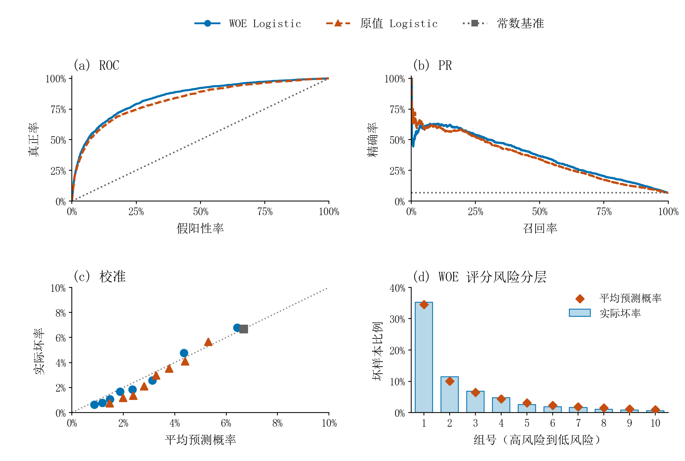

# Credit Risk Scorecard

**从违约概率到可解释信用评分，再到审批策略评估。**

基于 Kaggle **Give Me Some Credit** 的个人信贷风险项目，由信用评分课程作业整理而来。使用 15 万条有标签样本，完成数据审计、WOE 编码、逻辑回归、评分卡转换和阈值模拟，提供可复现脚本与无标签客户评分接口。

作者 [s0Ap224](https://github.com/s0Ap224) · Python 3.12 · pandas · scikit-learn

## 项目结果

在固定的 30,000 条本地留出测试样本上，WOE 评分模型达到 **AUC 0.8487、KS 0.5411、AP 0.3681**。训练、验证、测试按 60% / 20% / 20% 分层划分，随机种子为 `20261103`，测试集坏样本率为 6.6833%。所有成绩均为本地评估，Kaggle 排名及线上提交成绩尚未记录。

| 模型 | ROC-AUC ↑ | KS ↑ | AP ↑ | Brier ↓ |
|---|---:|---:|---:|---:|
| WOE + Logistic Regression | 0.8487 | 0.5411 | 0.3681 | 0.05073 |
| 原值转换 + Logistic Regression | 0.8252 | 0.5129 | 0.3484 | 0.05226 |
| 训练坏样本率常数基准 | 0.5000 | 0.0000 | 0.0668 | 0.06237 |

WOE 流程相对原值基线的 AUC 增加 0.0235。两条流程的表示、缩放及有效正则化存在差异，比较口径详见[方法说明](docs/methodology.md)。完整数值见[模型对比表](docs/results/model_comparison.csv)。



## 这个项目解决什么问题

- **风险排序** — 利用历史逾期、额度使用率和负债等信息，估计未来两年发生严重逾期的概率。
- **分数解释** — 将 8 个变量的模型转换成 43 个分箱及独立基准分，输出客户总分和每个变量的分值贡献。
- **决策模拟** — 在验证集选择风险标记阈值和审批门槛，冻结后评估测试表现，量化通过率、坏样本率和误判代价。

评分刻度采用好/坏几率 `19:1` 对应 `600` 分，几率翻倍增加 `20` 分。分数越高，预测风险越低。完整映射可查看[评分卡表](docs/results/scorecard.csv)。

## 从预测到决策

假设漏标一个坏样本的成本为 5，误标一个好样本的成本为 1。在验证集选择概率阈值 `0.13`，随后在测试集评价。

| 测试集指标 | 默认阈值 0.50 | 验证选择阈值 0.13 |
|---|---:|---:|
| 坏样本召回率 | 18.15% | 54.86% |
| 标记样本占比 | 2.03% | 10.88% |
| 精确率 | 59.87% | 33.69% |
| 假设成本合计 | 8,449 | 6,690 |

在上述成本假设下，合计成本下降 **20.82%**。这是离线决策模拟，成本单位由假设定义。详见[阈值比较表](docs/results/test_flag_comparison.csv)。

另一项审批模拟在验证集要求通过客户坏样本率不超过 5%，并要求通过率至少为 10%，选出 `531` 分门槛。测试集通过率为 **96.58%**，通过客户坏样本率为 **5.0563%**，高于目标，Wilson 95% 区间为 **[4.8099%, 5.3146%]**。结果用于展示验证选择后的泛化评估。详见[审批结果](docs/results/approval_comparison.csv)。

## 快速复现

已验证环境为 Windows / Python 3.12。默认流程生成数值结果，跳过绘图，因此不依赖中文字体。仓库内提供已导出的展示图。

1. 从 [Kaggle 官方数据页](https://www.kaggle.com/competitions/GiveMeSomeCredit/data) 下载 `cs-training.csv` 与 `Data Dictionary.xls`，放入项目根目录。数据使用遵循该比赛条款。
2. 在项目根目录创建环境并安装依赖。

```powershell
python -m venv .venv
.venv\Scripts\python.exe -m pip install -r requirements.txt
.venv\Scripts\python.exe run_pipeline.py
```

macOS / Linux 的环境解释器路径为 `.venv/bin/python`。完整运行生成 `results/` 与供报告使用的 `latex/tables/`，这些目录由 Git 忽略。各阶段校验输入哈希并保护冻结规则，遇到输入或规则变化时会停止并报告原因。

需要重新绘制三组中文图时，安装可用中文字体后运行 `python run_pipeline.py --with-figures`。原绘图配置使用 SimSun 和 Times New Roman。验证记录见 [复现检查](docs/verification.md)。

## 给一个新客户评分

完成复现后，使用仓库中的**人工构造示例**。

```powershell
.venv\Scripts\python.exe scripts/scorecard.py --customer-json examples/customer.json
```

输入包括十个原始特征，输出包含 `probability`、`score_unrounded`、`score_rounded_sum` 和逐项 `breakdown`。推理使用已保存的预处理、WOE 和模型参数。正式决策使用未取整分数。

可先浏览[示例评分结果](examples/customer_score.json)，查看输出结构与逐项解释。

## 代码导航

| 路径 | 功能 |
|---|---|
| `run_pipeline.py` | 按依赖顺序运行完整流程 |
| `scripts/split_samples.py`、`audit_data.py` | 固定划分与数据审计 |
| `scripts/preprocess.py`、`feature_risk.py` | 缺失/特殊编码处理与风险分析 |
| `scripts/binning_woe.py`、`fit_logistic.py` | 分箱、变量选择、模型训练与比较 |
| `scripts/scorecard.py` | 评分卡与单客户推理 |
| `scripts/evaluate_models.py` | ROC、PR、校准与风险分组 |
| `scripts/decision_thresholds.py`、`score_psi.py` | 阈值决策与分数分布比较 |
| `tests/` | 输入校验、WOE、模型与评分卡单元测试 |
| `docs/` | 方法、展示图、汇总结果和复现记录 |

```powershell
.venv\Scripts\python.exe -m unittest discover -s tests -v
.venv\Scripts\python.exe scripts/evaluate_models.py --smoke
.venv\Scripts\python.exe scripts/decision_thresholds.py smoke
```

## 数据与评估口径

数据来自 [Give Me Some Credit](https://www.kaggle.com/competitions/GiveMeSomeCredit)。目标变量为 `SeriousDlqin2yrs`，坏样本为正类。仓库公开代码、汇总结果和图表，原始数据及逐户预测在本地生成。

本次按记录随机分层，审计发现 246 个特征相同的组跨越子集。数据缺少可用于客户分组及时间外验证的标识。分数 PSI 为 0.000418，描述的是训练与测试随机子集之间的分布差异，长期稳定性需要后续时间数据评估。更多细节见[方法说明](docs/methodology.md)。
