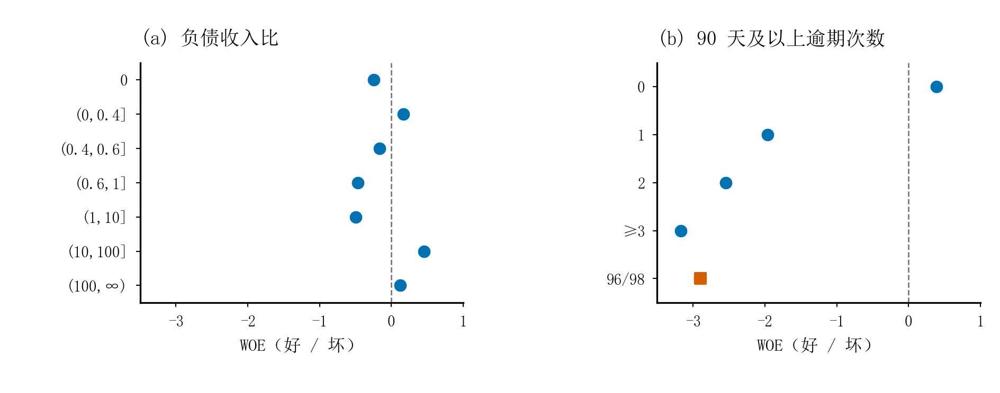
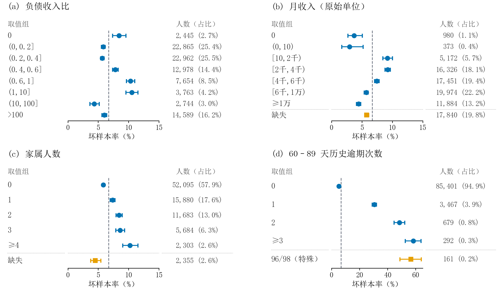

# 方法与实验口径

## 数据划分

使用官方 `cs-training.csv` 的 150,000 条记录，保留十个候选特征。原始行号用于对齐和审计。标签分层后得到训练 90,000、验证 30,000、测试 30,000 条，固定种子 20261103。全部原始记录保留，重复特征审计报告 354 个组，其中 246 个跨子集。该评估衡量随机留出表现。

## 特征处理与 WOE

年龄无效值使用训练有效年龄中位数填补；家属人数缺失保留指示后补零；月收入缺失和低收入分别识别。三类逾期中的 96/98 编码作为特殊状态。合法长尾保留，普通分箱两端开口覆盖新输入。

分箱方案见 `scripts/binning_woe.py`，训练样本估计每箱好坏分布、平滑 WOE 与 IV。候选变量按 IV 顺序尝试简化，验证集允许 AUC 下降不超过 0.001，且 Brier 与对数损失增量均不超过 0.0001。最终使用八个变量。所有新样本应用冻结处理和映射。分箱设计及模型选择涉及验证信息，测试评价在方案确定之后进行。

## 模型与比较

主模型为 WOE Logistic Regression，固定 `C=1`、L2、lbfgs、`tol=1e-8`、`max_iter=2000`，无类别权重。原值基线使用同一八个原始字段，除年龄外使用 log1p，并添加逾期特殊状态指示，共九个设计量，再用训练均值和标准差缩放。常数模型使用训练集坏样本率。

两流程相同的 C 在不同输入尺度下产生不同的有效惩罚，因此 AUC 差值反映流程比较。AP 按召回增量加权精确率；KS 为最大 TPR 与 FPR 差。校准与风险分组对同分样本保持完整。

## 评分与决策

令 B = 20 / ln(2)，A = 600 − B ln(19)。模型坏样本 logit 为 η 时，总分 S = A − Bη。基准分为 A − Bβ₀，每个变量分值为 −BβⱼWOEⱼ。概率通过 expit((A − S) / B) 反算。展示取整采用恰好半分时远离零，模型评价和阈值使用未取整总分。

风险标记使用概率大于等于阈值；审批使用分数大于等于门槛。阈值仅在验证集选择并冻结。漏标/误标成本 5:1、审批坏样本率上限 5% 和最低通过率 10% 均为模拟假设。测试审批坏样本率略超约束的情况在首页完整报告。

## 风险分析图

以下边际风险分析仅使用训练集，误差棒为 Wilson 95% 区间。它用于描述变量与风险的关联。

## 实现与来源

项目由课程作业代码整理，保留既有分箱、建模和评分逻辑。作品集新增统一运行入口、人工构造客户示例与文档，在评价脚本增加 `--stats-only` 选项。模型与数据处理的汇总资产使用 JSON，运行清单记录哈希和软件版本。`utils/` 中绘图辅助代码沿用原项目的 scipilot / 数学建模工具，并保留其来源注释。

数据下载和使用遵循 [Kaggle 比赛条款](https://www.kaggle.com/competitions/GiveMeSomeCredit/rules)。
